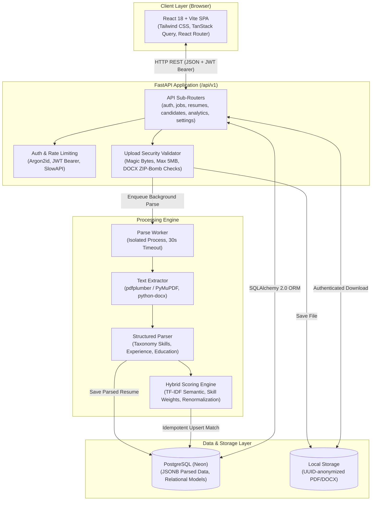

# HireLens

> AI-Powered Resume Screening and Candidate Ranking Platform

HireLens is an intelligent, explainable applicant tracking and resume screening system designed for recruiters. It automates the parsing of unstructured resumes (PDF and DOCX), extracts structured candidate data, and evaluates applicants against job openings using an explainable hybrid scoring engine combining skills taxonomy matching, TF-IDF semantic similarity, experience verification, and education alignment.

---

## 1. Problem Statement

Modern recruitment pipelines receive hundreds of resumes per job opening. Recruiters face severe challenges:

- **Time Inefficiency:** Manually reviewing hundreds of multipage resumes requires dozens of hours, creating recruitment bottlenecks.
- **Inconsistent Evaluation:** Manual screening is prone to human bias, fatigue, and inconsistent criteria application.
- **The "Black-Box" Problem:** Many commercial AI screening tools rely on opaque machine learning models that generate scores without explanation, making it impossible to understand why a candidate was ranked high or low, creating compliance and trust issues.
- **Security & Quality Vulnerabilities:** Ingestion of arbitrary public uploads exposes servers to malicious files (ZIP bombs, disguised executables) and spreadsheet software to formula injection attacks.

HireLens addresses these challenges by delivering an **explainable, transparent, and secure** screening pipeline where every score is accompanied by itemized evidence, matched/missing skill breakdowns, and audit trails.

---

## 2. Features

### Core AI Resume Screening Engine
- **Multi-Format Text Ingestion:** Robust text extraction from PDF (via `pdfplumber` with `PyMuPDF` fallback) and DOCX (via `python-docx`).
- **Rule-Based Structured Parsing:**
  - **Skill Extraction:** Matches against an extensible taxonomy of 200+ canonical technical skills and synonyms, capturing exact contextual evidence snippets.
  - **Experience Calculation:** Detects chronological employment history, parses diverse date formats, and computes merged non-overlapping professional tenure in years.
  - **Education Level Detection:** Maps academic degrees to hierarchical levels (Doctorate, Master's, Bachelor's, Associate, Diploma/Bootcamp).
  - **Contact Information:** Regex-based extraction of candidate names, emails, phone numbers, and portfolio links.
- **Explainable Hybrid Scoring Engine:**
  - **Skill Matching (40%):** Weighted evaluation differentiating required skills (2x weight) from preferred skills (1x weight), with detailed missing skill reporting.
  - **TF-IDF Semantic Similarity (30%):** Cosine similarity computed over document term frequencies between resume text and job description using n-grams.
  - **Experience Alignment (20%):** Verifies parsed candidate work tenure against job requirements using piecewise linear scoring with caps.
  - **Education Alignment (10%):** Compares candidate degree level against required minimum degree using hierarchical tier matching.
  - **Dynamic Renormalization:** Automatically and proportionally redistributes weights when job requirements lack specific components, ensuring fair scoring.
  - **Full Score Breakdown:** Every candidate match produces an explanation object containing sub-scores, weights applied, matched skill snippets, missing requirements, and notes.
- **Resilient Background Processing:** Asynchronous parse worker running isolated child processes with an enforced 30-second hard execution timeout and automatic startup recovery for pending/interrupted resumes.

### Supporting Recruiter Management Tools
- **Job Opening Management:** Full CRUD operations for job postings, including title, department, full description, minimum experience, and education requirements.
- **Automatic Job Requirement Extraction:** Instant extraction of required skills and qualifications from raw job description text.
- **Candidate Pipeline Tracking:** Recruiter-controlled workflow transitions (`new` → `screened` → `shortlisted` → `interview` → `rejected` → `hired`) with confirmation dialogs and bulk status updates.
- **Candidate Comparison:** Side-by-side comparison of 2–4 candidates highlighting score components, strengths, and missing requirements.
- **Analytics Dashboard:** Real-time metrics on total jobs, processed resumes, average match scores, candidate score distribution histograms, top extracted skills, and pipeline funnel stages.
- **Secure CSV Export:** Instant export of candidate ranking reports with automated CSV formula injection neutralization (CWE-1236 protection).
- **Recruiter Security & Access Control:**
  - Multi-tenant data isolation through strict owner-scoping across jobs, resumes, and candidates.
  - Modern authentication using Argon2id password hashing and short-lived JWT access tokens with 7-day refresh tokens.
  - SlowAPI brute-force rate limiting on authentication routes (5 requests/minute).
  - Upload security enforcing 5 MB size caps, 20-file batch limits, MIME magic-byte validation, and DOCX ZIP-bomb decompression limits.

---

## 3. Architecture

HireLens is built as a modular monolith: a FastAPI backend serving a RESTful API under `/api/v1`, a React frontend with Tailwind CSS, and a PostgreSQL database hosted on Neon.



---

## 4. Technology Stack

| Layer | Technologies |
|---|---|
| **Backend Framework** | Python 3.14, FastAPI 0.115+, Uvicorn |
| **Database & ORM** | PostgreSQL (Neon serverless), SQLAlchemy 2.0, Alembic |
| **Authentication & Security** | `argon2-cffi` (Argon2id hashing), `PyJWT` (JWT Access + Refresh tokens), `slowapi` (Rate limiting) |
| **Document Processing** | `pdfplumber`, `pymupdf` (PyMuPDF fallback), `python-docx`, `python-magic-bin` |
| **Natural Language & Matching** | `scikit-learn` (TF-IDF vectorizer & cosine similarity), `rapidfuzz` (Fuzzy string matching) |
| **Data Validation & Settings** | `pydantic` v2, `pydantic-settings` |
| **Frontend Framework** | React 18, Vite, JavaScript (JSX) |
| **Styling & Components** | Tailwind CSS v3, Radix UI primitives, Lucide React icons |
| **Client State & Routing** | TanStack Query v5, React Router DOM v6, Axios |
| **Data Visualization** | Recharts (Histograms, bar charts, pipeline funnels) |

---

## 5. Scoring Methodology

The hybrid ranking engine computes a composite match score from 0.0 to 100.0% using four independent dimensions:

$$\text{Total Score} = (w_{\text{skills}} \times S_{\text{skills}}) + (w_{\text{semantic}} \times S_{\text{semantic}}) + (w_{\text{exp}} \times S_{\text{exp}}) + (w_{\text{edu}} \times S_{\text{edu}})$$

### Default Weights
- **Skills ($w_{\text{skills}}$ = 0.40 / 40%):** Weighted overlap between candidate skills and job requirements. Required skills carry weight 2.0, while preferred skills carry weight 1.0.
- **Semantic ($w_{\text{semantic}}$ = 0.30 / 30%):** TF-IDF cosine similarity between full resume text and the job description text.
- **Experience ($w_{\text{exp}}$ = 0.20 / 20%):** Ratio of verified candidate experience years against the minimum required years ($S_{\text{exp}} = \min(100, (\text{candidate\_years} / \text{required\_years}) \times 100)$).
- **Education ($w_{\text{edu}}$ = 0.10 / 10%):** Hierarchical degree comparison based on academic credential tiers (Doctorate = 5, Master's = 4, Bachelor's = 3, Associate = 2, Diploma/Bootcamp = 1).

### Missing Component Weight Renormalization

When a job does not define a requirement (e.g., no minimum experience specified) or a resume lacks data for a dimension, setting the sub-score to zero would unfairly penalize the applicant. Instead, HireLens excludes that dimension and **proportionally renormalizes** the remaining active weights so they still sum to 1.0 (100%):

$$\text{Normalized Weight}_i = \frac{w_i}{\sum_{k \in \text{active}} w_k}$$

#### Numerical Example:
Suppose a job specifies required skills and a job description, but specifies **no minimum experience** and **no required education level**.
1. **Raw Sub-scores:**
   - Skills Score = $80.0\%$
   - Semantic Score = $60.0\%$
   - Experience Score = `None` (no requirement on job)
   - Education Score = `None` (no requirement on job)
2. **Active Weight Sum:**
   $$\sum w_{\text{active}} = w_{\text{skills}} + w_{\text{semantic}} = 0.40 + 0.30 = 0.70$$
3. **Renormalized Weights:**
   - Skills: $0.40 / 0.70 = 0.5714$ ($57.14\%$)
   - Semantic: $0.30 / 0.70 = 0.4286$ ($42.86\%$)
   - Experience: Excluded (`"-"` in UI)
   - Education: Excluded (`"-"` in UI)
4. **Final Composite Score:**
   $$\text{Total Score} = (0.5714 \times 80.0) + (0.4286 \times 60.0) = 45.712 + 25.716 = \mathbf{71.4\%}$$

---

## 6. Windows Setup & Execution Instructions

### Prerequisites
- Python 3.11+ (Python 3.14 verified)
- Node.js 20+ and npm
- Git
- Neon PostgreSQL database account (or any standard PostgreSQL 15+ database)

### Backend Setup

1. **Navigate to the backend directory:**
   ```powershell
   cd backend
   ```

2. **Create and activate a Python virtual environment:**
   ```powershell
   python -m venv .venv
   .\.venv\Scripts\Activate.ps1
   ```
   *(If PowerShell script execution is restricted, run: `Set-ExecutionPolicy -Scope Process -ExecutionPolicy Bypass`)*

3. **Install dependencies:**
   ```powershell
   pip install -r requirements.txt
   ```

4. **Configure environment variables:**
   Create a `.env` file from the example:
   ```powershell
   copy .env.example .env
   ```
   Edit `.env` and set your `DATABASE_URL` and a secure `JWT_SECRET` (minimum 32 characters).

5. **Apply database migrations:**
   ```powershell
   alembic upgrade head
   ```

6. **Start the backend development server:**
   ```powershell
   uvicorn app.main:app --reload --port 8000
   ```
   - API Documentation (Swagger): `http://localhost:8000/docs`
   - Health Check: `http://localhost:8000/api/v1/health`

### Frontend Setup

1. **Open a second terminal and navigate to the frontend directory:**
   ```powershell
   cd frontend
   ```

2. **Install node dependencies:**
   ```powershell
   npm install
   ```
   *(On Windows PowerShell, use `npm.cmd install` if `npm` command execution is restricted)*

3. **Configure environment variables:**
   ```powershell
   copy .env.example .env
   ```

4. **Start the frontend development server:**
   ```powershell
   npm run dev
   ```
   *(Or `npm.cmd run dev`)*
   - Open your browser at: `http://localhost:5173`

---

## 7. Environment Variables Reference

*(Variable names only — never commit secrets, values, or credentials to version control)*

### Backend (`backend/.env`)
| Variable Name | Purpose |
|---|---|
| `ENVIRONMENT` | Deployment environment mode (`development`, `production`, `test`) |
| `API_V1_PREFIX` | Base path prefix for API version 1 (`/api/v1`) |
| `FRONTEND_ORIGIN` | Allowed CORS origin URL for client requests |
| `DATABASE_URL` | PostgreSQL connection string (`postgresql+psycopg://...`) |
| `JWT_SECRET` | Secret key for signing and verifying JWT tokens (min 32 chars) |
| `ACCESS_TOKEN_EXPIRE_MINUTES` | Access token lifespan in minutes |
| `REFRESH_TOKEN_EXPIRE_DAYS` | Refresh token lifespan in days |
| `UPLOAD_DIR` | Local disk directory path for storing uploaded resumes |
| `MAX_UPLOAD_MB` | Maximum allowed upload file size in megabytes |
| `MAX_FILES_PER_BATCH` | Maximum number of files permitted in a single upload request |
| `EMBEDDINGS_ENABLED` | Toggle flag for neural embedding models |
| `WEIGHT_SKILLS` | Default scoring weight for skill matching |
| `WEIGHT_SEMANTIC` | Default scoring weight for semantic similarity |
| `WEIGHT_EXPERIENCE` | Default scoring weight for experience matching |
| `WEIGHT_EDUCATION` | Default scoring weight for education matching |

### Frontend (`frontend/.env`)
| Variable Name | Purpose |
|---|---|
| `VITE_API_URL` | Base HTTP URL of the backend API endpoints |

---

## 8. Implemented API Endpoints Summary

All routes are prefixed with `/api/v1`.

| Method | Endpoint | Description | Auth Required | Role |
|---|---|---|---|---|
| `GET` | `/health` | System health check (database ping & storage check) | No | Public |
| `POST` | `/auth/register` | Register a new recruiter account | No | Public |
| `POST` | `/auth/login` | Recruiter login (rate-limited 5/min, returns tokens) | No | Public |
| `POST` | `/auth/refresh` | Exchange valid refresh token for fresh access token | No | Public |
| `GET` | `/auth/me` | Retrieve profile of the currently authenticated user | Yes | Any |
| `GET` | `/users` | Paginated list of registered users | Yes | `admin` |
| `POST` | `/jobs` | Create a new job opening | Yes | Any |
| `GET` | `/jobs` | List recruiter's jobs with search, status filter & pagination | Yes | Any |
| `GET` | `/jobs/{id}` | Get job details and configuration | Yes | Any |
| `PUT` | `/jobs/{id}` | Update job opening information | Yes | Any |
| `DELETE` | `/jobs/{id}` | Delete job and cascade associated requirements & matches | Yes | Any |
| `POST` | `/jobs/{id}/extract-requirements` | Auto-extract skills and criteria from job description | Yes | Any |
| `POST` | `/jobs/{id}/requirements` | Add an explicit skill, experience, or education requirement | Yes | Any |
| `DELETE` | `/jobs/{id}/requirements/{req_id}` | Remove an explicit requirement | Yes | Any |
| `POST` | `/jobs/{id}/match` | Trigger batch re-scoring of parsed candidates for a job | Yes | Any |
| `GET` | `/jobs/{id}/ranking` | Retrieve ranked candidates with scores and explanations | Yes | Any |
| `GET` | `/jobs/{id}/candidates/{cand_id}/match`| Detailed breakdown and evidence for a specific candidate | Yes | Any |
| `GET` | `/jobs/{id}/export.csv` | Export candidate rankings to formula-sanitized CSV | Yes | Any |
| `POST` | `/jobs/{id}/compare` | Compare 2 to 4 candidates side-by-side | Yes | Any |
| `POST` | `/resumes/upload` | Bulk upload resumes (PDF/DOCX, magic-byte validated) | Yes | Any |
| `GET` | `/resumes/{id}` | Retrieve resume metadata and parsed contents | Yes | Any |
| `GET` | `/resumes/{id}/status` | Bounded polling status (`pending`, `processing`, `done`, `failed`) | Yes | Any |
| `GET` | `/resumes/{id}/file` | Authenticated secure download of stored resume document | Yes | Any |
| `DELETE` | `/resumes/{id}` | Delete resume record and associated file on disk | Yes | Any |
| `GET` | `/candidates` | Paginated list of candidates owned by authenticated recruiter | Yes | Any |
| `GET` | `/candidates/{id}` | Candidate profile with status history and notes | Yes | Any |
| `PATCH` | `/candidates/{id}/status` | Update candidate pipeline status with audit logging | Yes | Any |
| `POST` | `/candidates/bulk-status` | Bulk update status for multiple candidates | Yes | Any |
| `DELETE` | `/candidates/{id}` | Delete candidate and cascade-delete all resume files | Yes | Any |
| `GET` | `/analytics/dashboard` | Dashboard metrics (score distribution, skills, funnel) | Yes | Any |
| `GET` | `/settings/scoring-weights` | Get active default scoring weights | Yes | Any |
| `PUT` | `/settings/scoring-weights` | Update global scoring weights (must sum to 1.0) | Yes | Any |
| `POST` | `/settings/re-score-all` | Batch recalculate all existing candidate scores | Yes | Any |

---

## 9. Known Limitations

- **No Optical Character Recognition (OCR):** Resumes uploaded as image-only scans or flattened bitmap PDFs lack digital text. These are detected and cleanly transitioned to `failed` status with reason `scanned_or_empty`.
- **TF-IDF Semantic Matching:** Semantic similarity uses scikit-learn TF-IDF with n-grams rather than dense neural embedding models (e.g. BERT/Sentence-Transformers). While highly efficient, fast, and CPU-friendly, it relies on vocabulary overlap and may miss abstract synonyms not covered in the skills taxonomy.
- **Rule-Based Parsing Heuristics:** Section splitting and contact information extraction rely on regex patterns and heading heuristics. Highly unusual visual layouts (e.g., multi-column graphic designer resumes) may occasionally result in partial section misclassification.
- **In-Process Task Execution:** Asynchronous background processing executes via in-process workers with subprocess isolation rather than a distributed broker like Celery or Redis. While sufficient for single-instance deployments with startup recovery, horizontal scaling would require an external task queue.
- **Recruiter-Level Multi-Tenancy:** The application enforces strict owner-scoping per recruiter account. Team-level shared workspaces or organization-wide candidate pools are not currently supported.

---

## 10. License

This project is licensed under the MIT License — see the [LICENSE](LICENSE) file for details.
