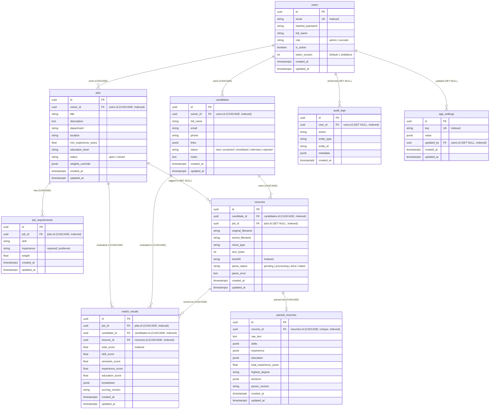

# HireLens Database Schema and Architecture

This document describes the PostgreSQL schema, Entity-Relationship (ER) model, foreign key behaviors, indexing strategy, and timestamp handling for the HireLens platform.

---

## 1. Entity-Relationship Diagram

---

## 2. Table Specifications

### 2.1 `users`
Represents system administrators and recruiters.
- `id` (UUID, PK): `gen_random_uuid()`
- `email` (VARCHAR(255), UNIQUE, NOT NULL, INDEXED): Login email, normalized to lowercase and trimmed.
- `hashed_password` (VARCHAR(255), NOT NULL): Argon2id password hash string.
- `full_name` (VARCHAR(255), NOT NULL): User's display name.
- `role` (VARCHAR(50), NOT NULL, DEFAULT `'recruiter'`): `'admin'` or `'recruiter'`.
- `is_active` (BOOLEAN, NOT NULL, DEFAULT `true`): Deactivated users are rejected at login and token refresh.
- `token_version` (INTEGER, NOT NULL, DEFAULT `1`): **Addition to Section 7.** Incremented whenever a user's password is changed or their account is deactivated. Refresh tokens carry the token version at issue time; tokens with stale versions are immediately rejected, enabling server-side revocation of refresh sessions.
- `created_at` (TIMESTAMPTZ, NOT NULL, DEFAULT `now()`)
- `updated_at` (TIMESTAMPTZ, NOT NULL, DEFAULT `now()`)

### 2.2 `jobs`
Job vacancies created by recruiters.
- `id` (UUID, PK): `gen_random_uuid()`
- `owner_id` (UUID, FK -> `users.id` ON DELETE CASCADE, INDEXED): Recruiter owning this vacancy.
- `title` (VARCHAR(255), NOT NULL): Job role title.
- `description` (TEXT, NOT NULL): Full job description text.
- `department` (VARCHAR(255), NULLABLE)
- `location` (VARCHAR(255), NULLABLE)
- `min_experience_years` (FLOAT, NULLABLE): Minimum years of experience expected.
- `education_level` (VARCHAR(100), NULLABLE): Required education level (e.g. `'bachelor'`, `'master'`).
- `status` (VARCHAR(50), NOT NULL, DEFAULT `'open'`): `'open'` or `'closed'`.
- `weights_override` (JSONB, NULLABLE): Per-job scoring weight overrides (must sum to 1.0).
- `created_at` (TIMESTAMPTZ, NOT NULL, DEFAULT `now()`)
- `updated_at` (TIMESTAMPTZ, NOT NULL, DEFAULT `now()`)

### 2.3 `job_requirements`
Structured skill requirements tied to specific jobs.
- `id` (UUID, PK): `gen_random_uuid()`
- `job_id` (UUID, FK -> `jobs.id` ON DELETE CASCADE, INDEXED): Associated job.
- `skill` (VARCHAR(255), NOT NULL): Canonical skill name from taxonomy.
- `importance` (VARCHAR(50), NOT NULL, DEFAULT `'required'`): `'required'` or `'preferred'`.
- `weight` (FLOAT, NOT NULL, DEFAULT `1.0`): Importance weight multiplier.
- `created_at` (TIMESTAMPTZ, NOT NULL, DEFAULT `now()`)
- `updated_at` (TIMESTAMPTZ, NOT NULL, DEFAULT `now()`)

### 2.4 `candidates`
Candidate records submitted to or screened in the system.
- `id` (UUID, PK): `gen_random_uuid()`
- `owner_id` (UUID, FK -> `users.id` ON DELETE CASCADE, INDEXED): Recruiter owning this candidate record.
- `full_name` (VARCHAR(255), NOT NULL): Candidate name extracted or specified.
- `email` (VARCHAR(255), NULLABLE)
- `phone` (VARCHAR(50), NULLABLE)
- `links` (JSONB, NULLABLE): Social/portfolio links (LinkedIn, GitHub).
- `status` (VARCHAR(50), NOT NULL, DEFAULT `'new'`): Pipeline status (`'new'`, `'screened'`, `'shortlisted'`, `'interview'`, `'rejected'`).
- `notes` (TEXT, NULLABLE): Recruiter evaluation notes.
- `created_at` (TIMESTAMPTZ, NOT NULL, DEFAULT `now()`)
- `updated_at` (TIMESTAMPTZ, NOT NULL, DEFAULT `now()`)

### 2.5 `resumes`
Uploaded resume file documents and processing lifecycle state.
- `id` (UUID, PK): `gen_random_uuid()`
- `candidate_id` (UUID, FK -> `candidates.id` ON DELETE CASCADE, INDEXED): Candidate owner.
- `job_id` (UUID, FK -> `jobs.id` ON DELETE SET NULL, INDEXED, NULLABLE): Job context for upload. Nullable so deleting a job does not delete candidate documents.
- `original_filename` (VARCHAR(255), NOT NULL): Original uploaded filename.
- `stored_filename` (VARCHAR(255), NOT NULL): Secure UUID-based filename on disk.
- `mime_type` (VARCHAR(100), NOT NULL): Verified MIME type (`application/pdf`, `application/vnd.openxmlformats-officedocument.wordprocessingml.document`).
- `size_bytes` (INTEGER, NOT NULL): File size in bytes.
- `sha256` (VARCHAR(64), NOT NULL, INDEXED): SHA-256 hash used for duplicate detection.
- `parse_status` (VARCHAR(50), NOT NULL, DEFAULT `'pending'`): `'pending'`, `'processing'`, `'done'`, `'failed'`.
- `parse_error` (TEXT, NULLABLE): Failure error code or sanitized explanation (no PII).
- `created_at` (TIMESTAMPTZ, NOT NULL, DEFAULT `now()`)
- `updated_at` (TIMESTAMPTZ, NOT NULL, DEFAULT `now()`)

### 2.6 `parsed_resumes`
Structured NLP parsing results extracted from resumes.
- `id` (UUID, PK): `gen_random_uuid()`
- `resume_id` (UUID, FK -> `resumes.id` ON DELETE CASCADE, UNIQUE, INDEXED): 1:1 relationship with resumes.
- `raw_text` (TEXT, NOT NULL): Cleaned resume text preserved for re-scoring without re-parsing.
- `skills` (JSONB, NOT NULL, DEFAULT `'[]'`): Extracted skills with evidence objects (`{skill, found_in, match_type, snippet}`).
- `experience` (JSONB, NOT NULL, DEFAULT `'[]'`): Structured job history with merged date ranges.
- `education` (JSONB, NOT NULL, DEFAULT `'[]'`): Degree levels and institutions.
- `total_experience_years` (FLOAT, NULLABLE): Total verified experience duration in years.
- `highest_degree` (VARCHAR(100), NULLABLE): Highest mapped educational degree.
- `sections` (JSONB, NULLABLE): Segmented text sections.
- `parser_version` (VARCHAR(50), NOT NULL, DEFAULT `'1.0.0'`): Parser taxonomy and pipeline version.
- `created_at` (TIMESTAMPTZ, NOT NULL, DEFAULT `now()`)
- `updated_at` (TIMESTAMPTZ, NOT NULL, DEFAULT `now()`)

### 2.7 `match_results`
Evaluated hybrid match scores and detailed explainability breakdowns.
- `id` (UUID, PK): `gen_random_uuid()`
- `job_id` (UUID, FK -> `jobs.id` ON DELETE CASCADE, INDEXED): Job matched against.
- `candidate_id` (UUID, FK -> `candidates.id` ON DELETE CASCADE, INDEXED): Candidate evaluated.
- `resume_id` (UUID, FK -> `resumes.id` ON DELETE CASCADE, INDEXED): Specific resume scored.
- `total_score` (FLOAT, NOT NULL, INDEXED): Overall hybrid score (0-100) indexed for candidate ranking queries.
- `skill_score` (FLOAT, NULLABLE): Sub-score for skills (0-100).
- `semantic_score` (FLOAT, NULLABLE): Sub-score for text similarity (0-100).
- `experience_score` (FLOAT, NULLABLE): Sub-score for experience duration (0-100).
- `education_score` (FLOAT, NULLABLE): Sub-score for education attainment (0-100).
- `breakdown` (JSONB, NOT NULL): Complete explainability breakdown object.
- `scoring_version` (VARCHAR(50), NOT NULL, DEFAULT `'1.0.0'`): Scoring algorithm and weights version.
- `created_at` (TIMESTAMPTZ, NOT NULL, DEFAULT `now()`)
- `updated_at` (TIMESTAMPTZ, NOT NULL, DEFAULT `now()`)
- **Constraints:** `UNIQUE(job_id, resume_id)` (`uq_match_results_job_resume`).

### 2.8 `audit_logs`
System activity audit trail without PII.
- `id` (UUID, PK): `gen_random_uuid()`
- `user_id` (UUID, FK -> `users.id` ON DELETE SET NULL, INDEXED, NULLABLE): Actor who triggered the action.
- `action` (VARCHAR(100), NOT NULL): Action identifier (`login`, `register`, `upload`, `delete`, `status_change`, `weight_change`, `export`).
- `entity_type` (VARCHAR(100), NOT NULL): Target entity type (`job`, `candidate`, `resume`, `setting`).
- `entity_id` (VARCHAR(100), NULLABLE): ID of the affected entity.
- `metadata` (JSONB, NULLABLE): Sanitized metadata (strictly no PII).
- `created_at` (TIMESTAMPTZ, NOT NULL, DEFAULT `now()`)

### 2.9 `app_settings`
Global application settings and default scoring weights.
- `id` (UUID, PK): `gen_random_uuid()`
- `key` (VARCHAR(100), UNIQUE, NOT NULL, INDEXED): Setting key name (e.g. `'scoring_weights'`).
- `value` (JSONB, NOT NULL): Setting value data.
- `updated_by` (UUID, FK -> `users.id` ON DELETE SET NULL, INDEXED, NULLABLE): Admin user who modified the setting.
- `created_at` (TIMESTAMPTZ, NOT NULL, DEFAULT `now()`)
- `updated_at` (TIMESTAMPTZ, NOT NULL, DEFAULT `now()`)

---

## 3. Maintenance of `updated_at`

In HireLens, `updated_at` is maintained as follows:

1. **Initial Insertion:**
   - Every table defining `updated_at` declares `server_default=func.now()`. When a row is inserted in PostgreSQL, the database engine initializes `updated_at` with the current transaction timestamp (`CURRENT_TIMESTAMP`).

2. **Subsequent Modifications:**
   - Every table model specifies `onupdate=func.now()` on the SQLAlchemy ORM `mapped_column`.
   - When an entity is modified and committed via the SQLAlchemy ORM session (`db.commit()`), SQLAlchemy automatically includes `updated_at = CURRENT_TIMESTAMP` in the executed SQL `UPDATE` statement.

3. **No Database Triggers:**
   - Per project guidelines, no automatic PostgreSQL triggers (`CREATE TRIGGER ... BEFORE UPDATE`) were installed without prior approval.
   - Any raw SQL `UPDATE` queries executed outside of the SQLAlchemy ORM will not automatically update `updated_at` unless explicitly specified in the query or until a database trigger migration is formally approved.

---

## 4. Indexing Strategy

To guarantee sub-50ms query latency for recruiter dashboards and candidate rankings:

| Index Target | Reason |
|---|---|
| All Foreign Keys (`*_id`, `updated_by`) | Prevents sequential scans during relational joins and cascade delete operations. |
| `users.email` | Unique index for $O(1)$ login lookup. |
| `match_results.total_score` | B-tree index for rapid candidate ranking and sorting (`ORDER BY total_score DESC`). |
| `resumes.sha256` | Index for instant duplicate file detection on upload. |
| `app_settings.key` | Unique index for global settings resolution. |
| `parsed_resumes.resume_id` | Unique index for 1:1 resume-to-parsed data joins. |
| `(job_id, resume_id)` | Composite unique constraint/index on `match_results` ensuring idempotent scoring. |
